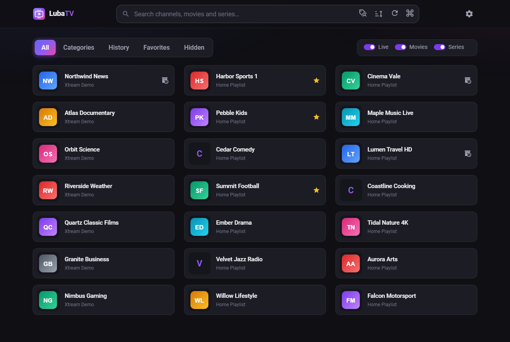
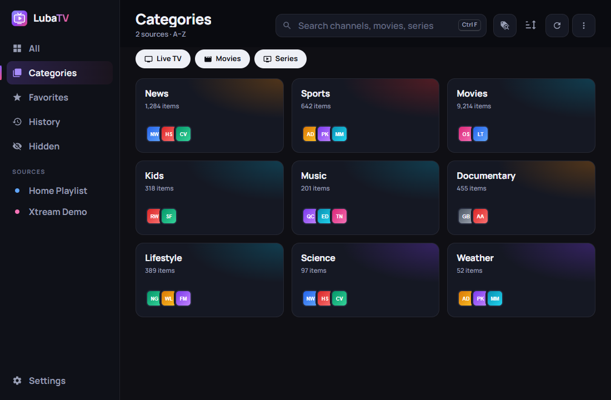
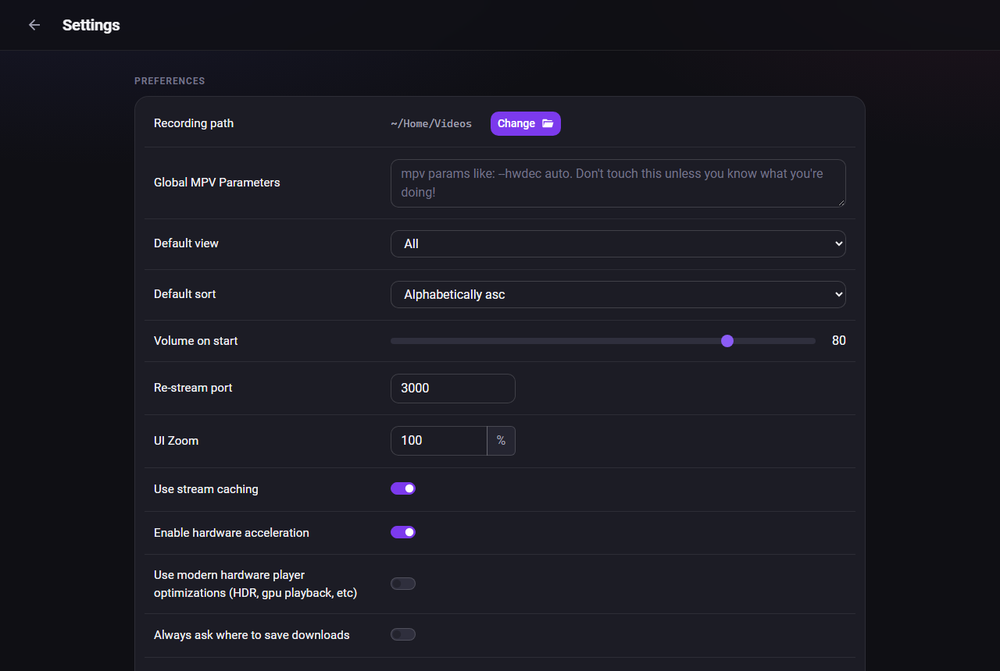
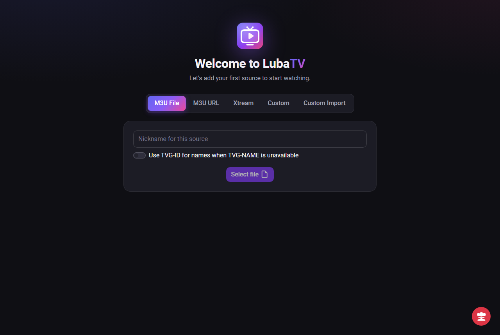

<p align="center">
  
</p>

<h1 align="center">LubaTV</h1>

<p align="center">
  A fast, keyboard-friendly IPTV player for the desktop, built with Tauri, Rust and Angular.
</p>



## Features

- **Any IPTV source:** M3U files, M3U links and Xtream accounts, with several sources at once
- **Live TV, movies and series**, with categories, seasons and episodes
- **Continue watching** on the home screen, and category tiles that preview what's inside
- **Instant search**, by whole phrase or by keywords
- **Favorites, history and hidden items**, with bulk hide and favorite from the search bar
- **EPG** for Xtream sources, with notifications for upcoming programmes
- **Catch-up** on channels that provide an archive
- **Record** live channels while you watch, and **download** movies
- **Re-stream** a channel to other devices on your network
- **Custom channels and groups** that you can export and share
- **Keyboard and TV-remote navigation**
- Playback through [mpv](https://mpv.io/), with optional hardware decoding and GPU rendering

| Categories | Settings |
|---|---|
|  |  |



## Install

Download the latest version from [Releases](https://github.com/LuisBadal0/LubaTV/releases/latest):

| Platform | File |
|---|---|
| Windows | `LubaTV_<version>_x64-setup.exe` (installs for your user, no admin needed) or `LubaTV_<version>_x64_en-US.msi` (installs for all users) |
| Debian / Ubuntu | `LubaTV_<version>_amd64.deb` |
| Fedora / openSUSE | `LubaTV-<version>-1.x86_64.rpm` |

The Windows installers are not code-signed yet, so SmartScreen may warn the first time: choose **More info → Run anyway**.

**Updates:** on Windows, LubaTV checks for a new version when it starts and offers to install it. You can also check any time in **Settings → About → Check for updates**. Linux packages are updated through your package manager.

## Requirements

LubaTV plays streams with **mpv**, uses **ffmpeg** to re-stream, and uses **yt-dlp** for some stream links.

- **Windows:** both installers include all three.
- **macOS and Linux:** install them with your package manager.

```
brew install mpv ffmpeg yt-dlp            # macOS
sudo dnf install mpv ffmpeg yt-dlp        # Fedora (needs RPM Fusion)
sudo zypper install mpv ffmpeg yt-dlp     # openSUSE
sudo pacman -Syu mpv ffmpeg yt-dlp        # Arch
sudo apt install mpv ffmpeg yt-dlp        # Debian / Ubuntu
```

On Debian-based LTS releases, a backported yt-dlp is recommended; the packaged version is often too old.

## Hotkeys

| Keys | Action |
|---|---|
| F1 | Show all hotkeys |
| Ctrl + F, Ctrl + Space | Search |
| Ctrl + A | All |
| Ctrl + S | Categories |
| Ctrl + D | History |
| Ctrl + R | Favorites |
| Ctrl + Q / W / E | Show or hide live TV / movies / series |
| Arrow keys, Tab, Shift + Tab | Move between items |
| Enter | Play or open |
| Backspace, Esc | Go back |

On macOS, Cmd works in place of Ctrl for search and the views.

## Settings worth knowing

**Stream caching:** turn it on if your connection or provider makes streams pause often. Turn it off for lower latency, or if streams drop completely and jump ahead or behind when they recover.

**Hardware acceleration** adds `hwdec=auto` to mpv. **Modern hardware optimizations** adds `--vo=gpu-next --profile=high-quality` for HDR and higher-quality GPU rendering. Anything else can go in **Global MPV parameters**.

## Building from source

You need [Node.js](https://nodejs.org/) 20 or newer, [Rust](https://www.rust-lang.org/tools/install) 1.91 or newer, and the [Tauri prerequisites](https://tauri.app/start/prerequisites/) for your platform.

```
npm ci
npm run tauri dev     # run in development
npm run build         # build packages into src-tauri/target/release/bundle
npm run build:windows # Windows: .exe and .msi installers with the player files included
```

`build:windows` needs the player files in `src-tauri/deps` first (see below).

### Releasing

Every merge to `main` builds the Windows installers and Linux packages. If the version is new, CI publishes them as GitHub release `v<version>` with notes listing the merged pull requests. To publish a release, bump the version in the same pull request, in all three of `package.json`, `src-tauri/Cargo.toml` and `src-tauri/tauri.conf.json`. CI fails if they differ. A merge that keeps an already-released version builds but publishes nothing.

Releases also publish `latest.json` and signatures for the Windows installers, which the in-app updater uses. CI signs them with the `TAURI_SIGNING_PRIVATE_KEY` and `TAURI_SIGNING_PRIVATE_KEY_PASSWORD` secrets; the matching public key is in `src-tauri/tauri.conf.json`. Keep a backup of the private key: without it, installed copies can't verify future updates.

### Player files on Windows

Installers ship mpv, ffmpeg and yt-dlp in a `deps` folder next to the app. Development builds look in `src-tauri/deps` instead. Fill it once with:

```
./scripts/fetch-windows-deps.ps1
```

The script copies the files from an installed LubaTV if it finds one, and otherwise downloads the same builds the release workflow uses. `-Download` forces a download, and `-Force` replaces existing files. The folder is git-ignored because the binaries are large. An mpv found on your `PATH` is still used first.

## Where LubaTV keeps its data

| | Database | Logs |
|---|---|---|
| Windows | `%APPDATA%\luisbadalo\lubatv\data` | `%LOCALAPPDATA%\luisbadalo\lubatv\cache\logs` |
| Linux | `~/.local/share/lubatv` | `~/.cache/lubatv/logs` |
| macOS | `~/Library/Application Support/dev.luisbadalo.lubatv` | `~/Library/Caches/dev.luisbadalo.lubatv/logs` |

The first time LubaTV starts, it copies your sources, favorites and settings from the app it was forked from, if that app is installed. It then asks once whether to delete that app's old folders or keep them (keep them if you still use it).

If something stays broken after an update, **Settings → Delete everything** resets the app.

## Privacy

LubaTV has no accounts, analytics or telemetry. It connects to the IPTV sources you add, the stream and logo addresses they list, and, when you re-stream, to [ipify](https://www.ipify.org/) to find your public IP address for the share link.

## Credits

LubaTV is made by [Luís Badalo](https://github.com/LuisBadal0), starting from a fork of the original app by [Frédéric Lachapelle](https://github.com/Fredolx). It is developed independently.

## License

[GPL-2.0](LICENSE).
